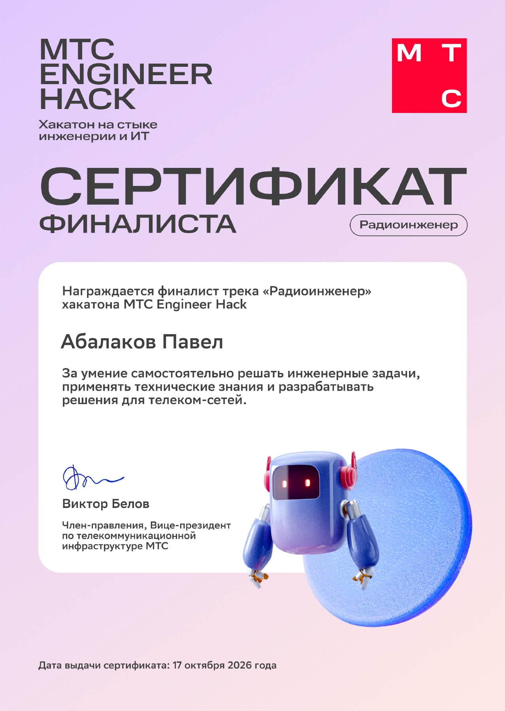

# Павел Абалаков

Студент третьего курса Уральского технического института связи и информатики (УрТИСИ)
Специальность: 11.03.02 «Инфокоммуникационные технологии и системы связи»

## Достижения

**Финалист трека «Радиоинженер»** — МТС Engineer Hack 2026,
17 октября 2026.

Сертификат за проект [mts-engineer-hack-2026-radio](https://github.com/abalakovpa/mts-engineer-hack-2026-radio).

**II место на Всероссийском хакатоне связи** — УрТИСИ СибГУТИ,
14–17 ноября 2025.

Награда за проект [svyaz-hack-payment-ocr](https://github.com/icyobsidian/svyaz-hack-payment-ocr).

**Сертификат участника** — Всероссийский хакатон связи, УрТИСИ СибГУТИ, 15–18 ноября 2024

## Проекты

- [mts-engineer-hack-2026-radio](https://github.com/abalakovpa/mts-engineer-hack-2026-radio)
  — проект indoor-системы связи для ТРК «Эльбрус», финалист трека «Радиоинженер» МТС Engineer Hack 2026.
- [svyaz-hack-payment-ocr](https://github.com/icyobsidian/svyaz-hack-payment-ocr)
  — проект, за который получено II место на Всероссийском хакатоне связи в 2025 году.
