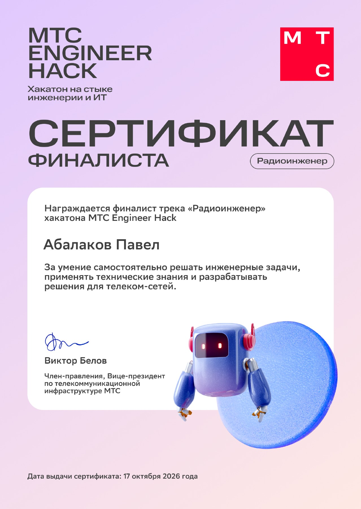
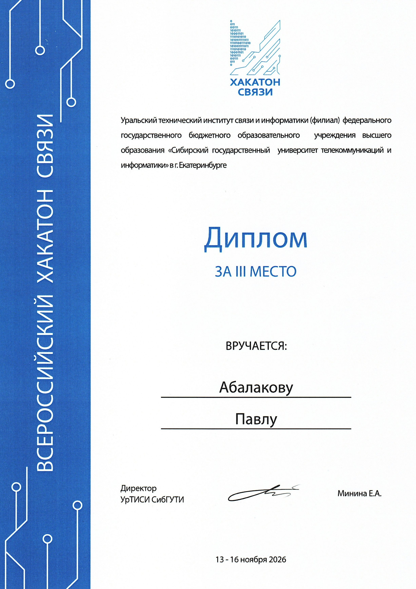
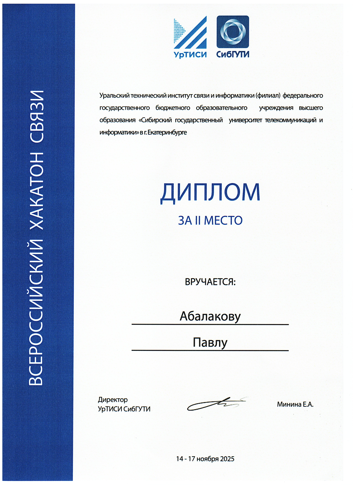
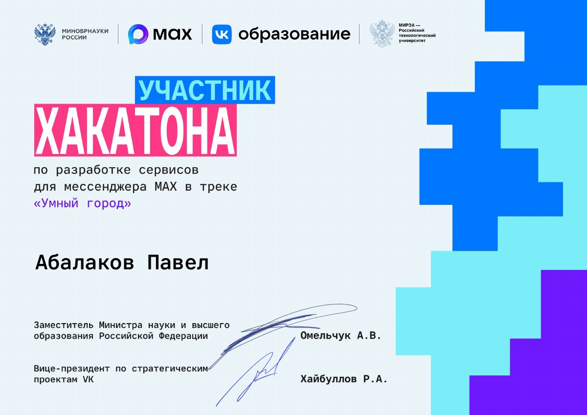
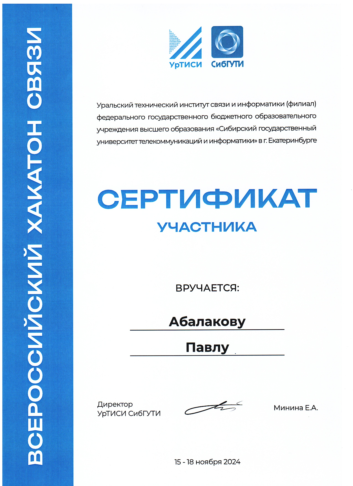

# Павел Абалаков

Студент третьего курса Уральского технического института связи и информатики (УрТИСИ)
Специальность: 11.03.02 «Инфокоммуникационные технологии и системы связи»

## Достижения

**Финалист трека «Радиоинженер»** — МТС Engineer Hack 2026,
17 октября 2026.

Сертификат за проект [mts-engineer-hack-2026-radio](https://github.com/abalakovpa/mts-engineer-hack-2026-radio).

**III место на Всероссийском хакатоне связи** — УрТИСИ СибГУТИ,
13–16 ноября 2026.

Награда за проект [rostelecom-field-dispatch](https://github.com/abalakovpa/rostelecom-field-dispatch).

**II место на Всероссийском хакатоне связи** — УрТИСИ СибГУТИ,
14–17 ноября 2025.

Награда за проект [svyaz-hack-payment-ocr](https://github.com/icyobsidian/svyaz-hack-payment-ocr).

**Участник трека «Умный город»** — хакатон MAX 2026.

Сертификат участника с проектом [max-magistral-dispatcher](https://github.com/abalakovpa/max-magistral-dispatcher).

**Сертификат участника** — Всероссийский хакатон связи, УрТИСИ СибГУТИ, 15–18 ноября 2024

## Резюме

[Скачать PDF](resume/%D0%9F%D0%B0%D0%B2%D0%B5%D0%BB%20%D0%90%D0%B1%D0%B0%D0%BB%D0%B0%D0%BA%D0%BE%D0%B2%20%E2%80%94%20%D1%80%D0%B5%D0%B7%D1%8E%D0%BC%D0%B5.pdf) · [Скачать Word](resume/%D0%9F%D0%B0%D0%B2%D0%B5%D0%BB%20%D0%90%D0%B1%D0%B0%D0%BB%D0%B0%D0%BA%D0%BE%D0%B2%20%E2%80%94%20%D1%80%D0%B5%D0%B7%D1%8E%D0%BC%D0%B5.docx)

## Проекты

- [max-magistral-dispatcher](https://github.com/abalakovpa/max-magistral-dispatcher)
  — «Диспетчер ЖКХ в MAX», чат-бот и мини-приложение для подачи заявок в управляющую компанию и отслеживания их статуса.
- [mts-engineer-hack-2026-radio](https://github.com/abalakovpa/mts-engineer-hack-2026-radio)
  — проект indoor-системы связи для ТРК «Эльбрус», финалист трека «Радиоинженер» МТС Engineer Hack 2026.
- [svyaz-hack-payment-ocr](https://github.com/abalakovpa/svyaz-hack-payment-ocr)
  — Telegram-бот для извлечения данных из платёжных счетов PDF и распознавания сканов. II место на Всероссийском хакатоне связи в 2025 году.
- [rostelecom-field-dispatch](https://github.com/abalakovpa/rostelecom-field-dispatch)
  — система диспетчеризации выездных бригад с расчётом маршрутов, картой и диаграммой Ганта. III место на Всероссийском хакатоне связи в 2026 году.
- [rostelecom-field-dispatch-dev](https://github.com/abalakovpa/rostelecom-field-dispatch-dev)
  — версия системы диспетчеризации с демонстрационным стендом и панелью для проверки сценариев перепланирования.
